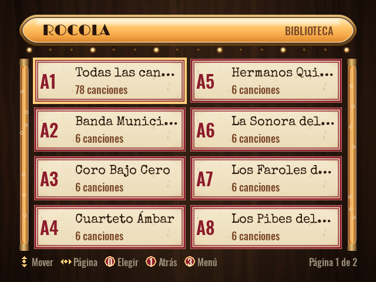

<div align="center">

# Rocola

**Convertí una computadora de escritorio vieja en una rocola con un solo pendrive.**<br>
[English](README.md) · [Descargar](https://github.com/bafif/rocola/releases/latest) · [Instalar](#instalar) ·
[Cómo se usa](#cómo-se-usa)

</div>

Arrancás una PC vieja desde el pendrive y aparece una rocola a pantalla completa, lista para sonar. Cuando lo
decidís, un instalador guiado la copia al disco interno: desde ahí la PC arranca directo en la rocola, se maneja con
controles de arcade y anda en un monitor moderno o de tubo. Suena por la salida analógica, HDMI, USB o parlantes
Bluetooth, y habla español e inglés.

<p align="center"> </p>

## Por qué Rocola

- **Se prueba sin tocar el disco.** El sistema en vivo corre en RAM sobre la imagen de solo lectura del pendrive:
  no se escribe nada en la PC hasta que instalás.
- **Nunca borra un disco por su cuenta.** El instalador se abre solo desde el menú y solo desde el pendrive; elegís
  el disco y tipeás una palabra de confirmación. Al reinstalar se puede conservar la música.
- **Hecha para PCs viejas.** Debian i386 con kernel PAE y uno sin PAE de respaldo, unos 2 GB de RAM, y arranque por
  BIOS (PCs de 32 y de 64 bits) o UEFI x64.
- **Controles de arcade sin configurar nada.** Los encoders que se presentan como teclado o como joystick andan a la
  vez, y «Probar controles» muestra qué manda cada botón.
- **También monitores de tubo.** Monitores VGA y pantallas de arcade o TV de 15 kHz, con modelines fijos; el tipo de
  monitor se elige una vez, al instalar. Los 15 kHz dependen de la placa de video y su driver.
- **La música queda.** Precargada en la imagen, o copiada desde un segundo pendrive apenas lo enchufás, a una
  partición `/music` que sobrevive a las reinstalaciones.

## Instalar

Hace falta un pendrive de 1 GB o más (**se borra entero**).

1. Bajá `rocola-i386-<versión>.iso` (unos 671 MiB) y su `SHA256SUMS.txt` de la
   [última versión](https://github.com/bafif/rocola/releases/latest).
2. Grabalo en el pendrive:

   | Herramienta | Cómo |
   |---|---|
   | Rufus (Windows) | «Escribir en modo Imagen DD» ([paso a paso](docs/13-rufus-windows.md)) |
   | Ventoy | instalá Ventoy en el pendrive una vez y después copiá el `.iso` adentro |
   | balenaEtcher | «Flash from file», el `.iso`, el pendrive, «Flash» |
   | `dd` (Linux) | `sudo dd if=rocola-i386-<versión>.iso of=/dev/sdX bs=4M conv=fsync` |

En una PC con UEFI, desactivá Secure Boot: el cargador de arranque no está firmado. Cómo comprobar la descarga y el
pendrive, y cómo probarlo en QEMU: [Grabar el pendrive](docs/10-flashing-usb.md).

### Armar la imagen

Con Podman (alcanza sin root) y `make`; todo lo demás corre en contenedores:

```sh
git clone https://github.com/bafif/rocola && cd rocola
make rootfs                # el SO como imagen de contenedor (FROM i386/debian:bookworm)
make image                 # out/rocola-i386.img: una ISO híbrida para BIOS y UEFI x64
make flash DEV=/dev/sdX    # la graba en el pendrive (lo borra)
```

El detalle está en [Pipeline de build](docs/02-build-pipeline.md).

## Cómo se usa

1. **Arrancá la PC vieja desde el pendrive**, con su menú de arranque o cambiando el orden de arranque. «Rocola» la
   abre en español; «Rocola — English», en inglés.
2. **Poné música.** Enchufá un segundo pendrive con canciones: se copian y aparecen en la biblioteca. Con las
   flechas y Enter te movés y elegís, F10 abre el menú, y los botones de arcade están en
   [Controles de arcade](docs/06-arcade-controls.md).
3. **Instalala.** Enchufá un teclado, abrí el menú y elegí «Instalar en disco». Elegí el idioma y el disco (14 GB o
   más), tipeá la palabra de confirmación y elegí el tipo de monitor. Sacá el pendrive y reiniciá: desde ahí la PC
   arranca directo en la rocola.

## Estado

- **Beta.** En QEMU/KVM anda de punta a punta: arranca hasta la rocola por BIOS y por UEFI x64, el instalador la
  clona a un disco vacío que después arranca solo, las canciones de un segundo pendrive aparecen en la biblioteca y
  al reinstalar se conserva la música.
- **En hardware real** el sistema en vivo arranca desde un pendrive con Ventoy. Todavía no se probaron ahí los
  15 kHz en un monitor de tubo, un encoder de arcade, el import desde un segundo pendrive ni reinstalar conservando
  la música.

## Más documentación

- [Arquitectura](ARCHITECTURE.md): cómo encajan las partes, las decisiones de fondo y cómo está organizado el repo.
- [Visión general](docs/01-overview.md): objetivos, lo que no busca y glosario.
- [Pipeline de build](docs/02-build-pipeline.md): del contenedor a la imagen, y los archivos de cada versión.
- [Arranque y modo en vivo](docs/03-boot-and-live.md): la cadena de arranque, el menú de arranque y la recuperación.
- [Instalador](docs/04-installer.md): sus pasos, las particiones y el modo desatendido.
- [Video](docs/05-display-crt-15khz.md): VGA, monitores de tubo de 15 kHz y el driver de video.
- [Controles de arcade](docs/06-arcade-controls.md): los botones, cómo reasignarlos y cómo probarlos.
- [La app](docs/07-rocola-app.md): las pantallas, el idioma, los ajustes y el desarrollo local.
- [Música](docs/08-music-management.md): precargarla, importarla desde un pendrive y organizarla.
- [Temas](docs/09-branding-theming.md): el formato de un tema, los tipos de pantalla, los efectos y las herramientas.
- [Grabar el pendrive](docs/10-flashing-usb.md): cada herramienta, cómo comprobar el pendrive y probarlo en QEMU.
- [Problemas comunes](docs/11-troubleshooting.md): build, arranque, video, audio, controles y SSH para depurar.
- [Verificación](docs/12-verificacion.md): los tests, y qué está probado en QEMU y en hardware real.
- [Rufus en Windows](docs/13-rufus-windows.md): el modo DD y qué significa cada opción.
- [Audio](docs/14-audio.md): PipeWire, cómo elegir la salida y Bluetooth.

## Licencia

[MIT](LICENSE) © 2026 Bautista D. Fiori
