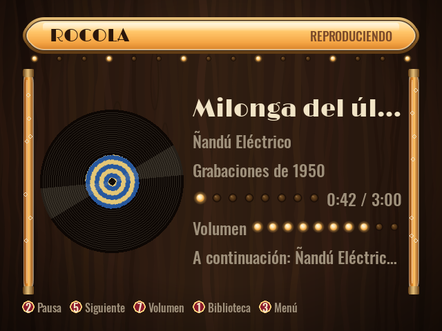
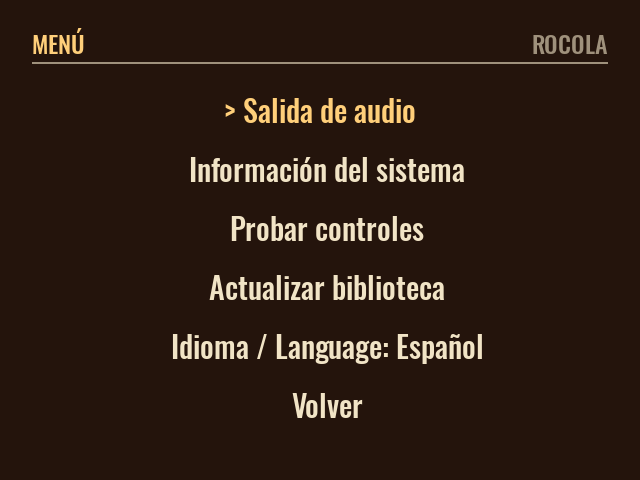
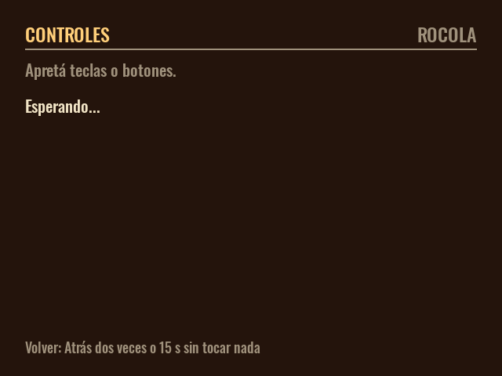

# Rocola

*[English](README.md) · Español*

> Convertí cualquier computadora de escritorio vieja en una rocola dedicada con un solo pendrive.

**Rocola** es un sistema operativo mínimo basado en **Debian i386** que se distribuye como una
**imagen booteable para pendrive**. Se arranca una PC vieja desde el pendrive y aparece una rocola
lista para sonar. Cuando lo decidís, un instalador guiado **clona** el sistema al disco interno y la
máquina queda como rocola permanente: **abre sola al prenderla**, se maneja con **controles de
arcade** y funciona en **monitores modernos y de tubo**, incluidos los de 15 kHz de arcade o de TV.

| Biblioteca | Reproduciendo |
|---|---|
|  |  |
| **Menú** | **Probar controles** |
|  |  |

Las capturas usan una biblioteca de demostración inventada.

## Qué tiene

- **Todo en un pendrive**: arranca una rocola en vivo sin tocar el disco de la PC (el sistema en
  vivo corre en RAM).
- **Instalador guiado y manual**: clona el sistema al disco interno solo cuando se lo pedís y con
  una confirmación explícita. Nunca formatea un disco por su cuenta, y al reinstalar puede conservar
  la partición de la música.
- **Pensado para hardware viejo**: CPU de 32 bits (i386) y unos 2 GB de RAM. Arranca por **BIOS**
  (PCs de 32 y de 64 bits) y por **UEFI x64**.
- **Monitores de tubo**: VGA (31 kHz) y monitores de arcade o TV de 15 kHz con `switchres` y
  modelines, con un modo VGA seguro de respaldo. El tipo de monitor se elige una sola vez, al
  instalar.
- **Controles de arcade**: los encoders USB que se presentan como teclado o como joystick andan los
  dos, a la vez y sin configurar nada.
- **Interfaz propia**: una pantalla completa de rocola hecha con **SDL2** (Python y pygame) sobre
  **MPD**. La biblioteca se recorre por artista y álbum, con la portada del disco en «Reproduciendo».
  El logo, las fuentes y los colores salen de un tema que se puede reemplazar.
- **Salidas de audio**: analógica, HDMI, USB y parlantes **Bluetooth** con PipeWire, elegibles desde
  la UI; en un sistema instalado la elección se mantiene entre reinicios.
- **Tu música**: precargada en la imagen y, además, importada desde un segundo pendrive a una
  partición `/music` persistente que sobrevive a las reinstalaciones.

## Estado

Beta. Está probada de punta a punta en QEMU/KVM: la ISO arranca hasta la UI a pantalla completa con
MPD conectado, por **BIOS y por UEFI x64**, y el instalador clona a un disco vacío que después
arranca solo, también por BIOS y por UEFI. Las canciones de un pendrive enchufado con la rocola
andando aparecen solas en la biblioteca. El sistema en vivo también arrancó en hardware real desde
Ventoy. Todavía no probé en hardware físico el video de 15 kHz en un CRT, un encoder de arcade real
ni el import de música desde un segundo pendrive. El detalle y los problemas que fueron apareciendo
están en [docs/12-verificacion.md](docs/12-verificacion.md).

## Descargar y grabar (sin compilar)

1. Bajá `rocola-i386-<versión>.iso` (unos 405 MB) de
   [Releases](https://github.com/bafif/rocola/releases).
2. Si querés, comprobalo contra el `SHA256SUMS.txt` del release:
   - Linux o macOS: `sha256sum -c SHA256SUMS.txt`
   - Windows (PowerShell): `Get-FileHash rocola-i386-*.iso -Algorithm SHA256`
3. Grabalo en un pendrive de 1 GB o más (**el pendrive se borra entero**):

   | Herramienta | Cómo |
   |-------------|------|
   | **Rufus** (Windows) | Elegí el pendrive y el `.iso`, y después **«Escribir en modo Imagen DD»**. Guía paso a paso: [docs/13](docs/13-rufus-windows.md). |
   | **Ventoy** (Windows/Linux) | Instalá Ventoy en el pendrive una vez y después **copiá** el `.iso` adentro. |
   | **balenaEtcher** | *Flash from file*, elegí el `.iso` y el pendrive, *Flash*. |
   | **dd** (Linux) | `make flash DEV=/dev/sdX` desde un clon de este repo, o `dd` a mano. |

El archivo es una imagen ISO 9660 híbrida (isohybrid): el mismo `.iso` arranca por BIOS y por UEFI
x64 y se puede grabar con cualquiera de las herramientas de arriba.

## Usarla

1. Enchufá el pendrive en la PC vieja y arrancá desde él (cambiá el orden de arranque si hace falta).
2. Arranca la rocola en vivo: ya puede sonar música.
3. Para instalarla: abrí el menú (**F10** o el botón 3 de arcade), elegí **Instalar en disco**, elegí
   el disco de destino (**14 GB o más**: 12 GB para el sistema y el resto para la música), confirmá,
   elegí el tipo de monitor (moderno/VGA o 15 kHz) y reiniciá.
4. Sacá el pendrive: desde ese momento la PC arranca directo en la rocola.

Controles por defecto (teclado o arcade):

| Acción | Teclado | Joystick (índice de botón de SDL) |
|--------|---------|-----------------------------------|
| Moverse | flechas | palanca / cruceta |
| Elegir / reproducir | Enter | 0 |
| Volver | Esc / Backspace | 1 |
| Reproducir / pausa | Espacio | 2 |
| Menú | F10 | 3 |
| Anterior / siguiente | P / N | 4 / 5 |
| Volumen − / + | − / + | 6 / 7 |

Hay más en [docs/06-arcade-controls.md](docs/06-arcade-controls.md).

## Cargar música

- **Precargada**: poné carpetas en `os/rootfs-overlay/opt/rocola/music/` antes de `make rootfs`.
- **Desde un pendrive**: enchufá un pendrive con canciones; la rocola lo detecta y las importa a la
  partición de datos (`/music`). Más en [docs/08-music-management.md](docs/08-music-management.md).

## Compilar desde el código

Hace falta **Docker** y `make`. Todo lo demás corre dentro de contenedores: no se necesita
`debootstrap`, ni loop devices, ni `--privileged`, así que también anda en WSL2 y en el CI. En un
host x86-64, Docker corre los contenedores i386 de forma nativa; en otros hosts hay que registrar
binfmt una vez (ver [docs/02-build-pipeline.md](docs/02-build-pipeline.md)).

```bash
make rootfs                        # arma el SO como imagen Docker (FROM i386/debian:bookworm)
make image                         # out/rocola-i386.img: ISO híbrida, BIOS + UEFI x64
make release VERSION=v0.1.2-beta   # out/release/rocola-i386-<versión>.iso + SHA256SUMS.txt
make flash DEV=/dev/sdX            # DESTRUCTIVO: graba la imagen en el pendrive
```

`make image` reutiliza la imagen del SO si ya existe; después de cambiar algo en `os/`, `app/`,
`installer/` o `display/` hay que volver a correr `make rootfs`.

Para probarla sin pendrive:

```bash
qemu-system-i386 -enable-kvm -m 2048 -cdrom out/rocola-i386.img
```

## Desarrollar la UI

La app está en [`app/`](app/) y usa [uv](https://docs.astral.sh/uv/) con Python 3.11 (la versión de
Debian bookworm).

```bash
make app-deps   # uv sync: pygame-ce, pytest, ruff
make app-test   # tests sin pantalla (driver dummy de SDL y un servidor MPD falso)
make os-test    # tests de los scripts del SO que corren sin root (import de música)
make app-lint   # ruff
make app-run    # la UI en una ventana; necesita un MPD local en 127.0.0.1:6600
```

La configuración sale de `/etc/rocola/rocola.toml` y de las variables de entorno `ROCOLA_*`
(`ROCOLA_RES=640x480` simula un CRT). `ROCOLA_SCREENSHOT=out.png` dibuja una escena en un PNG y
sale. Referencia: [docs/07-rocola-app.md](docs/07-rocola-app.md).

## Cómo está organizado

```
os/         el SO: Dockerfile (FROM i386/debian:bookworm) + archivos que se superponen a la raíz
image/      empaquetado: rootfs -> ISO híbrida booteable (squashfs + GRUB BIOS/UEFI)
app/        la UI de la rocola (Python + pygame/SDL2), cliente MPD, entrada, temas, tests
installer/  instalador guiado (TUI con whiptail) que clona el sistema al disco
display/    modelines de 15 kHz y detección VGA/CRT (switchres)
docs/       un documento por subsistema
```

El diseño completo está en [ARCHITECTURE.md](ARCHITECTURE.md).

## Documentación

| Doc | Tema |
|-----|------|
| [01](docs/01-overview.md) | Visión general y objetivos |
| [02](docs/02-build-pipeline.md) | Pipeline de build (de Docker a la imagen) |
| [03](docs/03-boot-and-live.md) | Arranque, sistema en vivo, autologin, autostart |
| [04](docs/04-installer.md) | Instalador guiado y particionado |
| [05](docs/05-display-crt-15khz.md) | Video: VGA y CRT de 15 kHz |
| [06](docs/06-arcade-controls.md) | Controles de arcade |
| [07](docs/07-rocola-app.md) | La app (UI SDL2 + MPD) |
| [08](docs/08-music-management.md) | Manejo de la música |
| [09](docs/09-branding-theming.md) | Branding y temas |
| [10](docs/10-flashing-usb.md) | Grabar el pendrive |
| [11](docs/11-troubleshooting.md) | Problemas comunes |
| [12](docs/12-verificacion.md) | Qué está probado y qué falta |
| [13](docs/13-rufus-windows.md) | Grabar con Rufus en Windows |
| [14](docs/14-audio.md) | Salida de audio (PipeWire), Bluetooth y elección de la salida |

## Salvedades

- La salida de 15 kHz depende de una placa de video y un driver que acepten modelines de baja
  frecuencia; donde no los hay, el sistema vuelve a un modo VGA seguro.
- `make flash` **borra** el dispositivo de destino: revisá `DEV` dos veces.

## Licencia

[MIT](LICENSE) © 2026 Bautista D. Fiori
