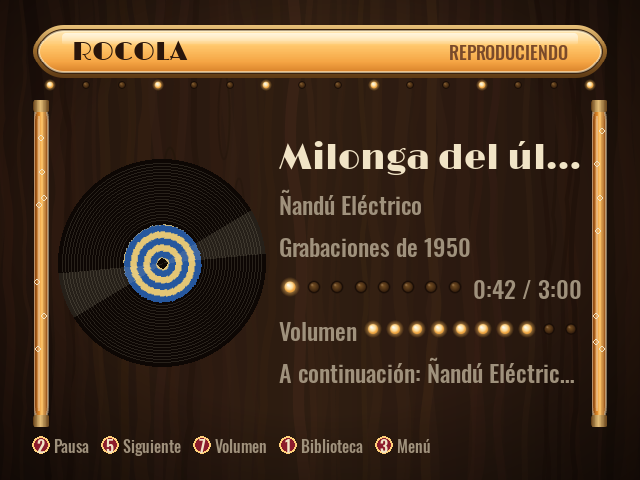
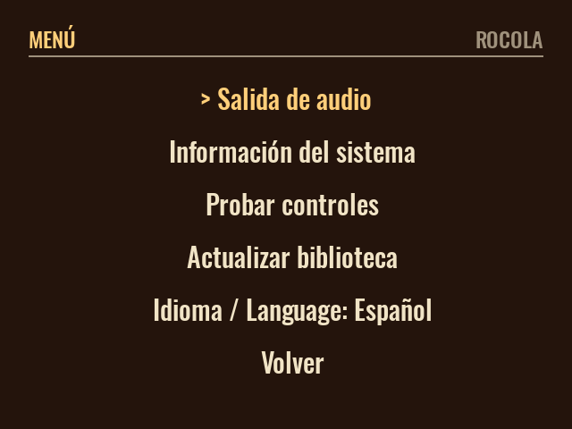

# Rocola

*English · [Español](README.es.md)*

> Turn any old desktop PC into a dedicated **jukebox** with a single USB stick.

**Rocola** is a minimal operating system based on **Debian i386** that ships as a **bootable USB
image**. Boot an old PC from the stick and a jukebox comes up, ready to play. When you decide to,
a guided installer **clones** the system to the internal disk, so the machine becomes a permanent
jukebox that **starts on power-on**, is driven with **arcade controls**, and works on **modern
monitors and CRTs**, including 15 kHz arcade/TV screens.

| Now playing | Menu |
|---|---|
|  |  |

## Features

- **All-in-one USB stick**: runs a live jukebox without touching the PC's disk (the live system
  runs from RAM).
- **Guided, manual installer**: clones the system to the internal disk only when you ask, with an
  explicit confirmation. It never formats a disk on its own, and reinstalling can keep the music
  partition.
- **Old hardware first**: 32-bit (i386) CPUs and around 2 GB of RAM. Boots with **BIOS** (32- and
  64-bit PCs) and **UEFI x64**.
- **CRT support**: VGA (31 kHz) and 15 kHz arcade/TV monitors through `switchres` and modelines,
  with a safe VGA fallback. The monitor type is chosen once, at install time.
- **Arcade controls**: USB encoders that show up as a keyboard or as a joystick both work, at the
  same time, with no setup.
- **Its own UI**: a full-screen jukebox interface written with **SDL2** (Python + pygame) on top
  of **MPD**. Browse the library by artist and album, with album covers on the now playing
  screen. Logo, fonts and colors come from a replaceable theme.
- **Audio outputs**: analog, HDMI, USB and **Bluetooth** speakers through PipeWire, selectable
  from the UI; on an installed system the choice survives reboots.
- **Your music**: preloaded in the image, plus import from a second USB stick into a persistent
  `/music` partition that survives reinstalls.

## Status

Beta. Verified end to end in QEMU/KVM: the ISO boots to the full-screen UI with MPD connected, over
**BIOS and UEFI x64**, and the installer clones to an empty disk that then boots on its own, also
over BIOS and UEFI. Songs on a USB stick plugged in while it runs show up in the library on their
own. The live system was also booted on real hardware from Ventoy. Not yet validated
on physical hardware: 15 kHz video on a real CRT, a real arcade encoder, and music import from a
second USB stick. Details and the bugs found along the way:
[docs/12-verificacion.md](docs/12-verificacion.md).

## Download and flash (no build needed)

1. Download `rocola-i386-<version>.iso` (about 405 MB) from
   [Releases](https://github.com/bafif/rocola/releases).
2. Optionally, check it against the release's `SHA256SUMS.txt`:
   - Linux / macOS: `sha256sum -c SHA256SUMS.txt`
   - Windows (PowerShell): `Get-FileHash rocola-i386-*.iso -Algorithm SHA256`
3. Write it to a USB stick of 1 GB or more (**the stick is erased**):

   | Tool | How |
   |------|-----|
   | **Rufus** (Windows) | Select the stick and the `.iso`, then choose **"Write in DD Image mode"**. Step-by-step guide (Spanish): [docs/13](docs/13-rufus-windows.md). |
   | **Ventoy** (Windows/Linux) | Install Ventoy on the stick once, then just **copy** the `.iso` to it. |
   | **balenaEtcher** | *Flash from file*, pick the `.iso` and the stick, *Flash*. |
   | **dd** (Linux) | `make flash DEV=/dev/sdX` from a clone of this repo, or `dd` by hand. |

The file is a hybrid ISO 9660 image (isohybrid): the same `.iso` boots over BIOS and UEFI x64 and
can be written with any of the tools above.

## Use

1. Plug the stick into the old PC and boot from it (change the boot order if needed).
2. The live jukebox starts: music can play right away.
3. To install it: open the menu (**F10** or arcade button 3), choose **Instalar en disco**, pick the
   target disk (**14 GB or more**: 12 GB for the system, the rest for music), confirm, pick the
   monitor type (modern/VGA or 15 kHz) and reboot.
4. Remove the stick: from now on the PC boots straight into the jukebox.

Default controls (keyboard / arcade):

| Action | Keyboard | Joystick (SDL button index) |
|--------|----------|-----------------------------|
| Move | arrow keys | stick / D-pad |
| Select / play | Enter | 0 |
| Back | Esc / Backspace | 1 |
| Play / pause | Space | 2 |
| Menu | F10 | 3 |
| Previous / next | P / N | 4 / 5 |
| Volume − / + | − / + | 6 / 7 |

More in [docs/06-arcade-controls.md](docs/06-arcade-controls.md).

## Adding music

- **Preloaded**: put folders in `os/rootfs-overlay/opt/rocola/music/` before `make rootfs`.
- **From USB**: plug in a stick with songs; the jukebox detects it and imports them into the data
  partition (`/music`). See [docs/08-music-management.md](docs/08-music-management.md).

## Build from source

Requirements: **Docker** and `make`. Everything else runs inside containers; no `debootstrap`,
loop devices or `--privileged` are needed, so it also works in WSL2 and CI. On x86-64 hosts Docker
runs the i386 containers natively; on other hosts, register binfmt once (see
[docs/02-build-pipeline.md](docs/02-build-pipeline.md)).

```bash
make rootfs                        # build the OS as a Docker image (FROM i386/debian:bookworm)
make image                         # out/rocola-i386.img: hybrid ISO, BIOS + UEFI x64
make release VERSION=v0.1.2-beta   # out/release/rocola-i386-<version>.iso + SHA256SUMS.txt
make flash DEV=/dev/sdX            # DESTRUCTIVE: writes the image to the stick
```

`make image` reuses the OS image if it already exists; run `make rootfs` again after changing
anything under `os/`, `app/`, `installer/` or `display/`.

To try it without a stick:

```bash
qemu-system-i386 -enable-kvm -m 2048 -cdrom out/rocola-i386.img
```

## Developing the UI

The app lives in [`app/`](app/) and uses [uv](https://docs.astral.sh/uv/) with Python 3.11
(Debian bookworm's version).

```bash
make app-deps   # uv sync: pygame-ce, pytest, ruff
make app-test   # tests, headless (SDL dummy driver and a fake MPD server)
make app-lint   # ruff
make app-run    # the UI in a window; needs a local MPD on 127.0.0.1:6600
```

Settings come from `/etc/rocola/rocola.toml` and `ROCOLA_*` environment variables
(`ROCOLA_RES=640x480` simulates a CRT). `ROCOLA_SCREENSHOT=out.png` renders one scene to a PNG and
exits. Reference: [docs/07-rocola-app.md](docs/07-rocola-app.md).

## Layout

```
os/         the OS: Dockerfile (FROM i386/debian:bookworm) + files overlaid on the root filesystem
image/      packaging: rootfs -> bootable hybrid ISO (squashfs + GRUB BIOS/UEFI)
app/        the jukebox UI (Python + pygame/SDL2), MPD client, input, themes, tests
installer/  guided installer (whiptail TUI) that clones the system to disk
display/    15 kHz modelines and VGA/CRT detection (switchres)
docs/       one document per subsystem
```

Design overview: [ARCHITECTURE.md](ARCHITECTURE.md).

## Documentation

The detailed docs are in Spanish.

| Doc | Topic |
|-----|-------|
| [01](docs/01-overview.md) | Overview and goals |
| [02](docs/02-build-pipeline.md) | Build pipeline (Docker to image) |
| [03](docs/03-boot-and-live.md) | Boot, live system, autologin, autostart |
| [04](docs/04-installer.md) | Guided installer and partitioning |
| [05](docs/05-display-crt-15khz.md) | Video: VGA and 15 kHz CRT |
| [06](docs/06-arcade-controls.md) | Arcade controls |
| [07](docs/07-rocola-app.md) | The app (SDL2 UI + MPD) |
| [08](docs/08-music-management.md) | Music management |
| [09](docs/09-branding-theming.md) | Branding and themes |
| [10](docs/10-flashing-usb.md) | Flashing the USB stick |
| [11](docs/11-troubleshooting.md) | Troubleshooting |
| [12](docs/12-verificacion.md) | What is tested and what is not |
| [13](docs/13-rufus-windows.md) | Flashing with Rufus on Windows |
| [14](docs/14-audio.md) | Audio output (PipeWire), Bluetooth and output selection |

## Caveats

- 15 kHz output depends on a GPU and driver that accept low-frequency modelines; where they do
  not, the system falls back to a safe VGA mode.
- `make flash` **erases** the target device: check `DEV` twice.

## License

[MIT](LICENSE) © 2026 Bautista D. Fiori
