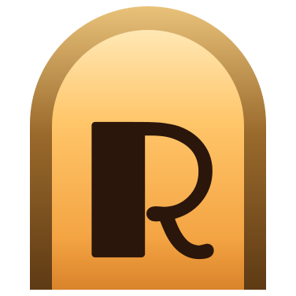
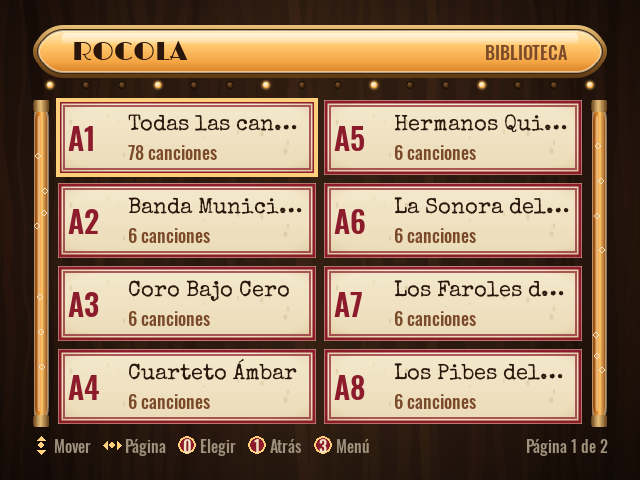

<div align="center">



# Rocola

**Turn an old desktop PC into a jukebox with a single USB stick.**<br>
[Español](README.es.md) · [Download](https://github.com/bafif/rocola/releases/latest) · [Install](#install) ·
[How to use it](#how-to-use-it)

</div>

Boot an old PC from the stick and a full-screen jukebox comes up, ready to play. When you decide to, a guided
installer copies it to the internal disk: from then on the PC starts straight into the jukebox, driven with arcade
controls, on a modern monitor or a CRT. It plays through analog, HDMI, USB or Bluetooth speakers and speaks English
and Spanish.

<p align="center"> </p>

## Why Rocola

- **Try it without touching the disk.** The live system runs in RAM on top of the stick's read-only image: nothing
  is written to the PC until you install.
- **It never wipes a disk on its own.** The installer opens only from the menu, and only from the stick; you pick
  the disk and type a confirmation word. Reinstalling can keep the music.
- **Made for old PCs.** Debian i386 with a PAE kernel and a non-PAE fallback, about 2 GB of RAM, and boot over BIOS
  (32- and 64-bit PCs) or UEFI x64.
- **Arcade controls with no setup.** Encoders that show up as a keyboard or as a joystick work at the same time,
  and «Test controls» shows what each button sends.
- **CRTs too.** VGA monitors and 15 kHz arcade or TV screens, with fixed modelines; the monitor type is chosen
  once, when installing. 15 kHz depends on the video card and its driver.
- **Music that stays.** Preloaded in the image, or copied from a second USB stick as soon as you plug it in. Once
  installed, it lives in a `/music` partition that survives reinstalls.

## Install

You need a USB stick of 1 GB or more (**it gets erased**).

1. Download `rocola-i386-<version>.iso` (about 671 MiB) and its `SHA256SUMS.txt` from the
   [latest release](https://github.com/bafif/rocola/releases/latest).
2. Write it to the stick:

   | Tool | How |
   |---|---|
   | Rufus (Windows) | «Write in DD Image mode» ([step by step](docs/13-rufus-windows.en.md)) |
   | Ventoy | install Ventoy on the stick once, then copy the `.iso` onto it |
   | balenaEtcher | «Flash from file», the `.iso`, the stick, «Flash» |
   | `dd` (Linux) | `sudo dd if=rocola-i386-<version>.iso of=/dev/sdX bs=4M conv=fsync` |

On a UEFI PC, turn Secure Boot off: the boot loader isn't signed. Checking the download and the stick, and trying
it in QEMU: [Flashing the USB stick](docs/10-flashing-usb.en.md).

### Building the image

With Podman (rootless is enough) and `make`; everything else runs in containers:

```sh
git clone https://github.com/bafif/rocola && cd rocola
make rootfs                # the OS as a container image (FROM i386/debian:bookworm)
make image                 # out/rocola-i386.img: a hybrid ISO for BIOS and UEFI x64
make flash DEV=/dev/sdX    # writes it to the stick (erases it)
```

Details in [Build pipeline](docs/02-build-pipeline.en.md).

## How to use it

1. **Boot the old PC from the stick**, from its boot menu or by changing the boot order. «Rocola — English» starts
   it in English; «Rocola», in Spanish.
2. **Play music.** Plug in a second stick with songs: they are copied and show up in the library. The arrows and
   Enter move and pick, F10 opens the menu, and the arcade buttons are in
   [Arcade controls](docs/06-arcade-controls.en.md).
3. **Install it.** Plug in a keyboard, open the menu and choose «Install to disk». Pick the language and the disk
   (14 GB or more), type the confirmation word and pick the monitor type. Remove the stick and reboot: from then on
   the PC starts straight into the jukebox.

## Status

- **Beta.** In QEMU/KVM it works end to end: it boots to the jukebox over BIOS and UEFI x64, the installer clones
  it to an empty disk that then boots on its own, songs from a second stick show up in the library, and
  reinstalling keeps the music.
- **On real hardware** the live system boots from a Ventoy stick. Not tried there yet: 15 kHz on a CRT, an arcade
  encoder, importing from a second stick and reinstalling while keeping the music.

## More documentation

- [Architecture](ARCHITECTURE.en.md): how the pieces fit together, the main decisions and the repository layout.
- [Overview](docs/01-overview.en.md): goals, non-goals and glossary.
- [Build pipeline](docs/02-build-pipeline.en.md): from the container to the image, and the release files.
- [Boot and live mode](docs/03-boot-and-live.en.md): the boot chain, the boot menu and recovery.
- [Installer](docs/04-installer.en.md): its steps, the partitions and the unattended mode.
- [Video](docs/05-display-crt-15khz.en.md): VGA, 15 kHz CRTs and the video driver.
- [Arcade controls](docs/06-arcade-controls.en.md): the buttons, remapping them and testing them.
- [The app](docs/07-rocola-app.en.md): the screens, the language, the settings and local development.
- [Music](docs/08-music-management.en.md): preloading it, importing it from a stick and organizing it.
- [Themes](docs/09-branding-theming.en.md): the theme format, kinds of display, effects and tools.
- [Flashing the USB stick](docs/10-flashing-usb.en.md): every tool, checking the stick and trying it in QEMU.
- [Troubleshooting](docs/11-troubleshooting.en.md): build, boot, video, audio, controls and SSH for debugging.
- [Verification](docs/12-verificacion.en.md): the tests, and what is tested in QEMU and on real hardware.
- [Rufus on Windows](docs/13-rufus-windows.en.md): DD mode and what each option means.
- [Audio](docs/14-audio.en.md): PipeWire, choosing the output and Bluetooth.

## License

[MIT](LICENSE) © 2026 Bautista D. Fiori
